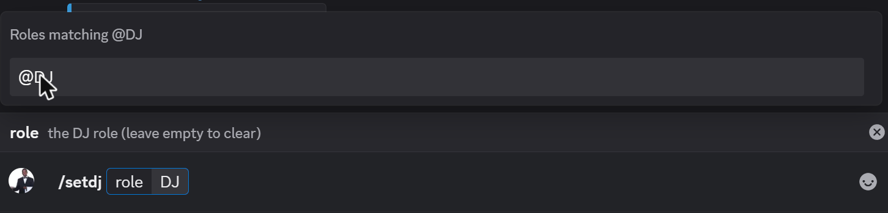

# DJ role and permissions

Anyone can add songs and vote to skip. Controlling playback for everyone (pausing, stopping, changing the volume,
skipping without a vote, reordering the queue) is for **DJs**. You choose who's a DJ by picking a role.

<figure class="oa-media" markdown>
{ width="830" }
</figure>

## Set the DJ role

An admin runs:

```text
/setdj role:@DJ
```

Everyone with that role is now a DJ in this server. To clear it, run `/setdj` with no role, or `setdj NONE`. If you pick `@everyone`, everyone is a
DJ, which suits a small group of friends.

People with the **Manage Server** permission are always DJs, whether or not they have the role. The bot owner can
do everything.

## Who can do what

| Level | Who | Examples |
|---|---|---|
| Everyone | Anyone in the server | `/play`, `/queue`, `/history`, `/skip` (votes), `/remove` your own songs; Skip and Prev on your own song |
| DJ | The DJ role, plus Manage Server | Pause, Stop, volume, Shuffle and Repeat buttons; `/forceskip`, `/movetrack`, `/skipto`, `/playnext`, `/library` |
| Admin | Manage Server | `/setdj`, `/settc`, `/setvc`, `/setskip`, `/prefix`, `/queuetype`, `/nplayout`, `/npbuttons`, `/settings` |
| Owner | The `owner` in `config.txt` | `/clearchannel`, `playlist`, `setname`, `setavatar`, `shutdown` |

The [Commands](../reference/commands.md) page lists every command by level.

## Skipping by vote

Anyone can `/skip`. The person who asked for the song skips it right away; anyone else adds a vote. The song is
skipped once enough of the people listening have voted: 55% by default.

Admins change the share for their server with `/setskip` (0 to 100). `0` means one vote is enough. The default for
all servers is `playback.skipRatio` in `config.txt`. DJs can always skip straight away with `/forceskip`.

## Keep music to one channel

- `/settc #music` makes the bot answer music commands only in that text channel.
- `/setvc` limits the bot to one voice channel.

To remove a limit, run the slash command with no channel, or use `settc NONE` / `setvc NONE`.

## Who can use it

Setting the DJ role and the channel limits is for admins (Manage Server).

## Settings

| Setting | Default | What it does |
|---|---|---|
| `playback.skipRatio` | `0.55` | Share of listeners needed to vote-skip, unless a server sets its own. |

Per-server choices (DJ role, channels, skip share) are saved in `serversettings.json` next to the bot. Change them
with commands rather than by editing that file.

Next: [Audio sources](sources.md).
