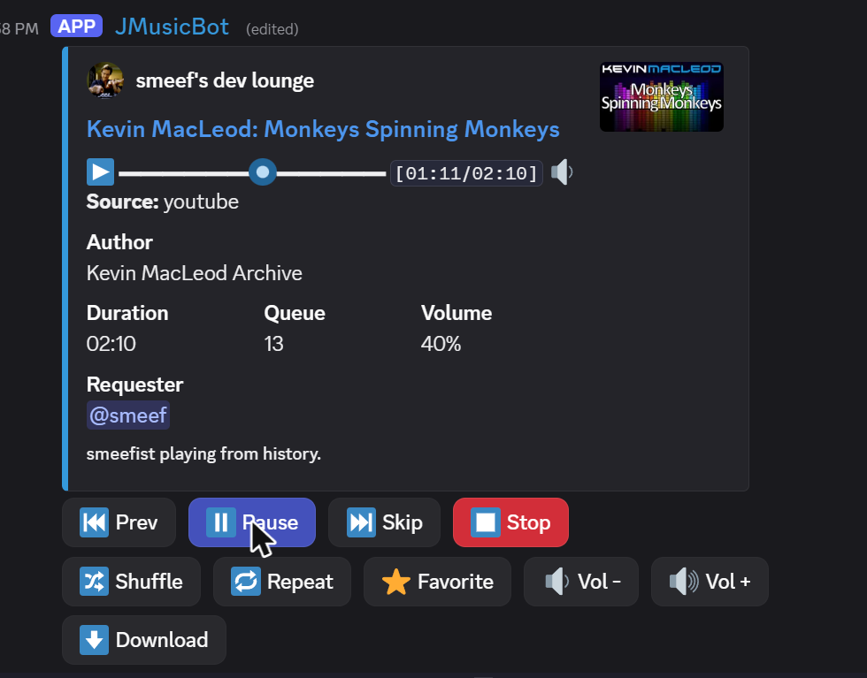
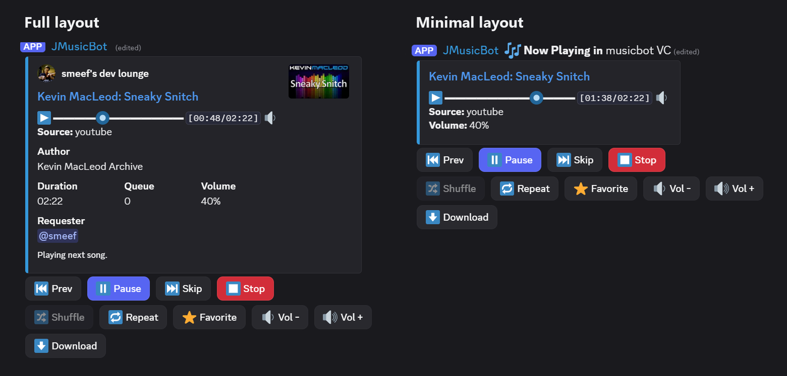

# Now-playing panel

When a song starts, the bot posts a now-playing message in the channel: the song, who asked for it, and buttons
to control playback. People can pause, skip or turn the volume up without typing a command.

<figure class="oa-media" markdown>
{ width="560" }
</figure>

## The buttons

| Button | What it does | Who can press it |
|---|---|---|
| ⏮ Prev | Restarts the song if it's more than 5 seconds in; otherwise plays the previous song again. | DJs, and the person who asked for the song |
| ⏸ Pause / ▶ Resume | Pauses or resumes. | DJs |
| ⏭ Skip | Skips the song. | DJs, and the person who asked for it |
| ⏹ Stop | Stops, clears the queue and leaves. | DJs |
| 🔀 Shuffle | Shuffles the queue. | DJs |
| 🔁 Repeat | Cycles between repeat off, repeat all and repeat one. | DJs |
| ⭐ Favorite | Saves the song to the `favorites` playlist. | DJs |
| 🔉 Vol - / 🔊 Vol + | Turns the volume down or up by 10. | DJs |
| ⬇ Download | Saves the song to the [yt-dlp library](ytdlp-library.md). Only shown when the library is set up. | DJs |

You need to be in the same voice channel as the bot to use any button. A button greys out when it can't do
anything, such as Shuffle with only one song queued. To skip without being a DJ, use `/skip`, which starts a vote.

## Layouts

There are two layouts. Admins pick one per server with `/nplayout`:

- **full** (the default): a card with the song, author, length, queue size, volume and requester.
- **minimal**: a shorter message with just the song, its progress and the volume.

<figure class="oa-media" markdown>

</figure>

`/npbuttons off` hides the buttons in a server, for a plain message. `inherit` in either command goes back to what
`config.txt` says.

## Progress bar

With `nowPlaying.showProgressBar = true`, the message shows a bar like `▬▬▬▬🔘▬▬▬▬▬▬▬` and the time, and refreshes
every 10 seconds. It's off by default.

## How to use it

- It appears on its own when a song starts.
- `/nowplaying` (or `/np`) posts it again, for example if it has scrolled up.
- `/nplayout` and `/npbuttons` change it for your server (admins).

## Settings

| Setting | Default | What it does |
|---|---|---|
| `nowPlaying.minimalMessage` | `false` | Use the minimal layout everywhere, unless a server overrides it. |
| `nowPlaying.showButtons` | `true` | Show the buttons, unless a server overrides it. |
| `nowPlaying.showProgressBar` | `false` | Show the progress bar and refresh every 10 seconds. |
| `nowPlaying.images` | `false` | Show the song's thumbnail in the full layout. |

See the [config.txt reference](../reference/config.md#nowplaying).

Next: [Queue, history and playlists](queue-history-playlists.md).
