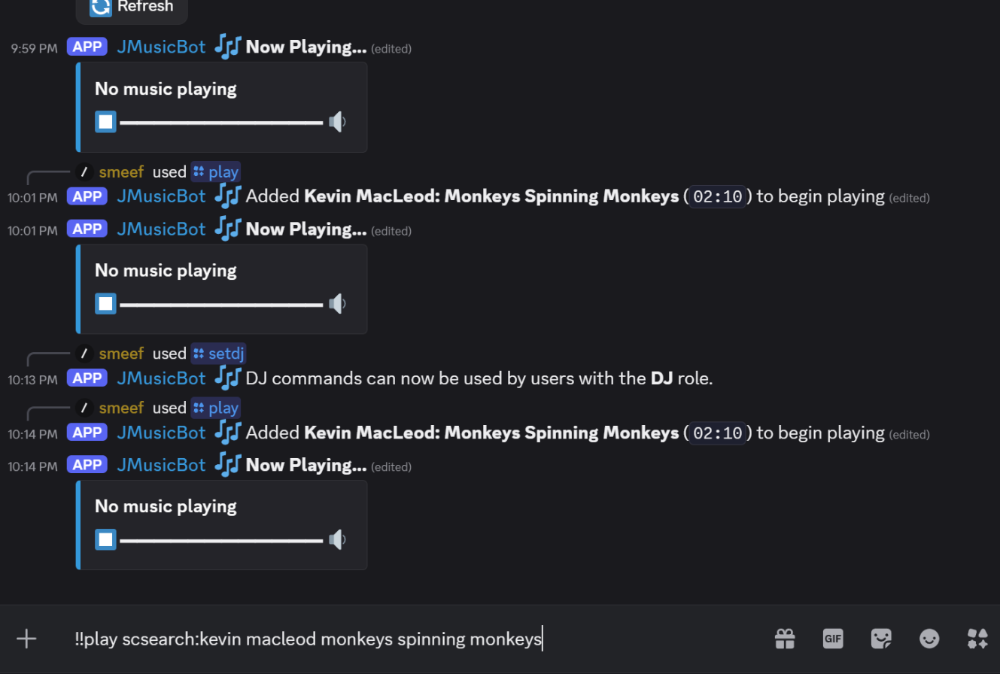

# Audio sources

The bot plays from links, from searches, and from files. Paste a link into `/play`, type a song name to search
YouTube, or attach an audio file to a `play` message.

<figure class="oa-media" markdown>
{ width="760" }
<figcaption>This server has the extra prefix <code>!!</code> set. On a default install, type <code>@JMusicBot play</code> followed by the same link or <code>scsearch:</code> search.</figcaption>
</figure>

## Sites and streams

| Source | Examples |
|---|---|
| YouTube | Videos, playlists, live streams, and searches by name (`/search`). |
| SoundCloud | Tracks and playlists. Search with `scsearch`. |
| Bandcamp | Tracks and albums. |
| Vimeo | Videos. |
| Twitch | Live streams. |
| Beam | Live streams. |
| getyarn.io | Short clips. |
| NicoNico | Videos. |
| Bilibili (哔哩哔哩) | Videos, by link, `BV` id or `b23.tv` short link. Search with `bilisearch`. |
| HTTP links | Direct links to audio files, and internet radio streams, including M3U and PLS playlists. |
| Local files | Files on the bot's computer, by path. |

### Bilibili

Paste a Bilibili video link into `play` and the bot queues its audio. Video URLs, bare `BV` ids and `b23.tv` short
links all work, and no Bilibili account is needed.

`bilisearch` (alias `bsearch`) searches Bilibili by keyword and lets you pick a result, the same way `scsearch` does
for SoundCloud.

A video with several parts (分P) always plays exactly one part: the one named by `?p=` in the link, or part 1 when
the link doesn't say. It is never expanded into the whole queue.

### Turning sources off

Each source can be turned off in `config.txt`, for example to stop people playing files from the bot's computer:

```hocon
playback {
  audioSources {
    local = false
  }
}
```

## File formats

The bot can play MP3, FLAC, WAV, Matroska and WebM (AAC, Opus or Vorbis), MP4 and M4A (AAC), OGG streams (Opus,
Vorbis and FLAC), and AAC streams.

## When a song won't play

If a song fails to load, the bot says so and moves on. For YouTube songs that won't play, see
[Troubleshooting](../help/troubleshooting.md#songs-wont-play). The [yt-dlp library](ytdlp-library.md) can also
download those and play them from disk.

## Who can use it

Everyone can play from any source that's turned on. Only the bot owner can turn sources on or off.

## Settings

| Setting | Default | What it does |
|---|---|---|
| `playback.audioSources.<source>` | `true` | Turn a source on or off: `youtube`, `soundcloud`, `bandcamp`, `vimeo`, `twitch`, `beam`, `getyarn`, `nico`, `bilibili`, `http`, `local`. |
| `playback.maxTrackSeconds` | `0` | Longest song allowed, in seconds. `0` means no limit. |
| `playback.maxYouTubePlaylistPages` | `10` | How much of a YouTube playlist to load, 100 songs per page. |

The bot plays these sources through [lavaplayer](https://github.com/lavalink-devs/lavaplayer), so anything
lavaplayer supports works here.

Next: [Desktop app](gui.md).
