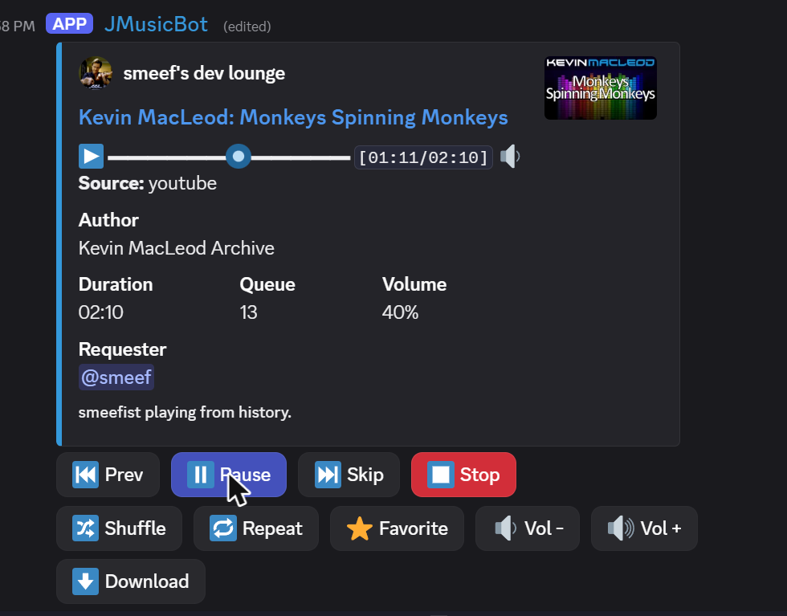
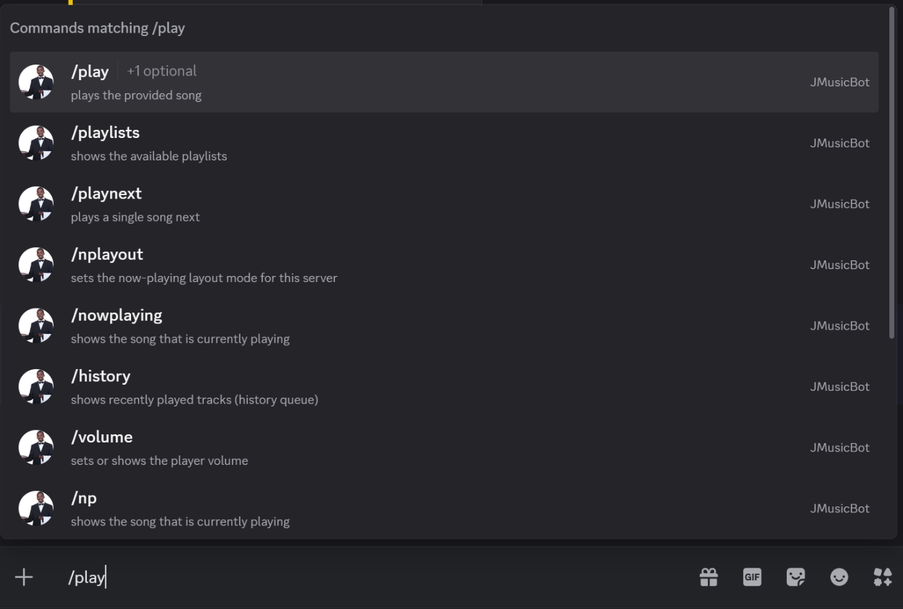
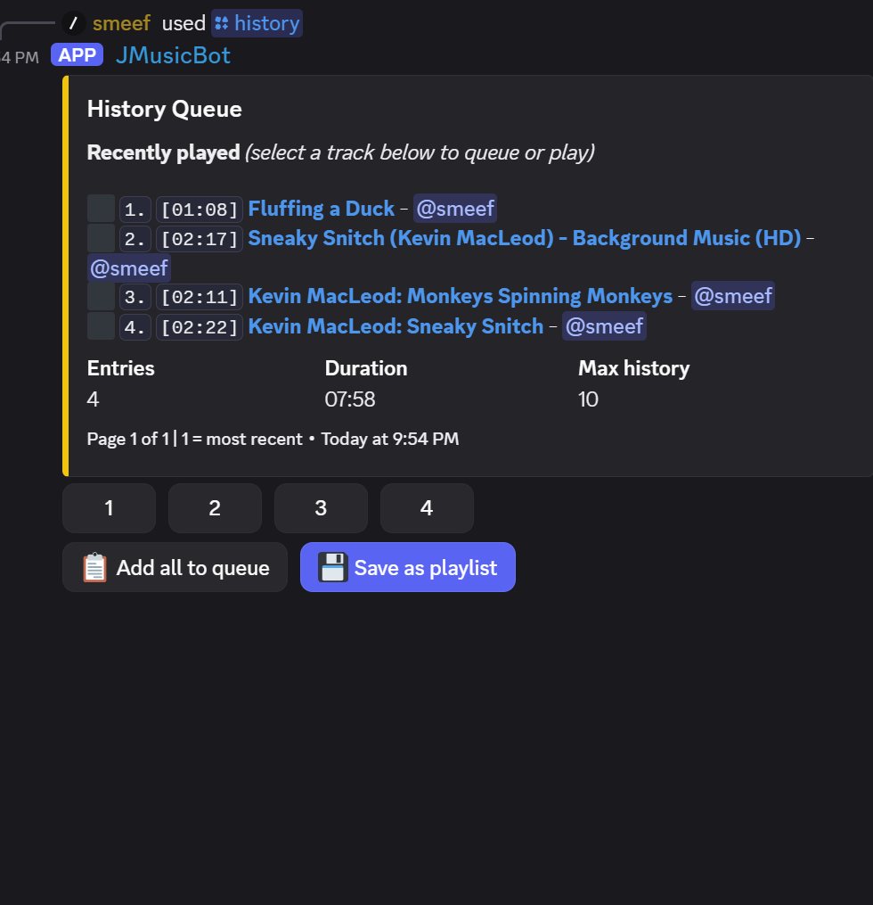
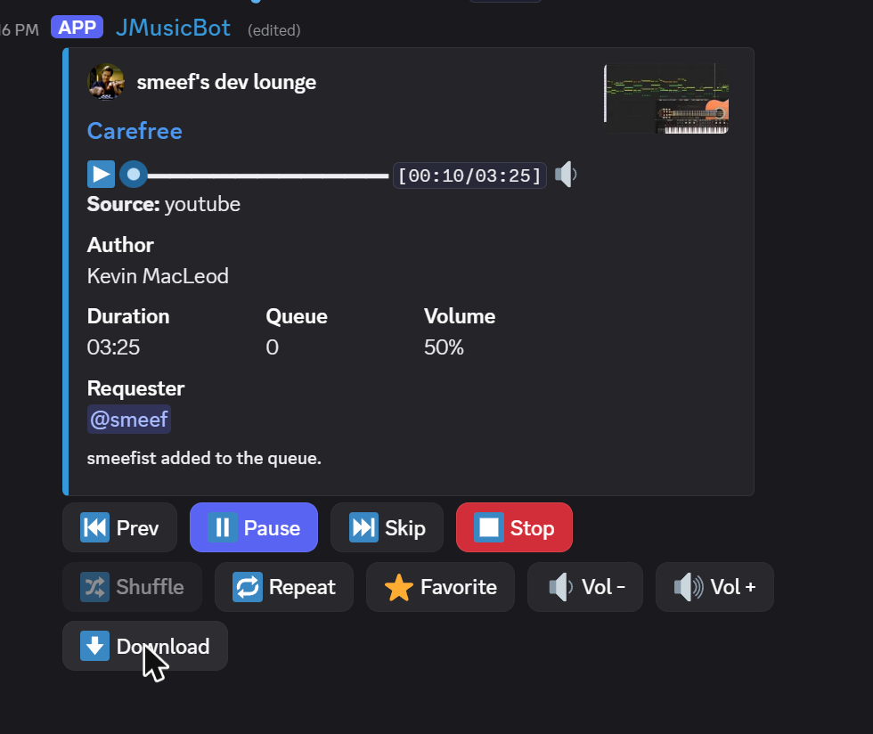
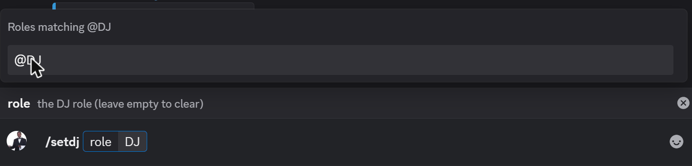

## A control panel for every song

Pause, skip, change the volume or save a favorite with buttons right under the song, without typing a command.
Choose the full layout or a compact one for each server.

[See the now-playing panel](features/now-playing.md)

<figure class="oa-media" markdown>
{ width="560" }
</figure>

## Slash commands with suggestions

Type `/play` and pick the right song from the suggestions before it plays. Every command shows up when you type
`/`, and text commands like `@JMusicBot play` still work.

[See slash commands](features/slash-commands.md)

<figure class="oa-media" markdown>
{ width="760" }
</figure>

## Replay what just played

`/history` lists recent songs with buttons to play one again or save them all as a playlist. Fair queues take
turns between the people adding songs.

[See queue, history and playlists](features/queue-history-playlists.md)

<figure class="oa-media" markdown>
{ width="560" }
</figure>

## Keep songs that won't stream

Connect your own yt-dlp and the bot can download a song when it won't play, then play it from disk next time.
Browse what you've saved with `/library panel`.

[See the yt-dlp library](features/ytdlp-library.md)

<figure class="oa-media" markdown>
{ width="560" }
</figure>

## You decide who's in charge

Pick a DJ role to control playback for everyone, while anyone can still add songs and vote to skip. Keep music
commands to one channel if you like.

[See the DJ role](features/dj-role.md)

<figure class="oa-media" markdown>
{ width="830" }
</figure>

## See what the bot is doing

On a computer with a screen, the bot opens a window with its log, audio performance and settings. On a server it
runs quietly in the terminal or in Docker.

[See the desktop app](features/gui.md)

