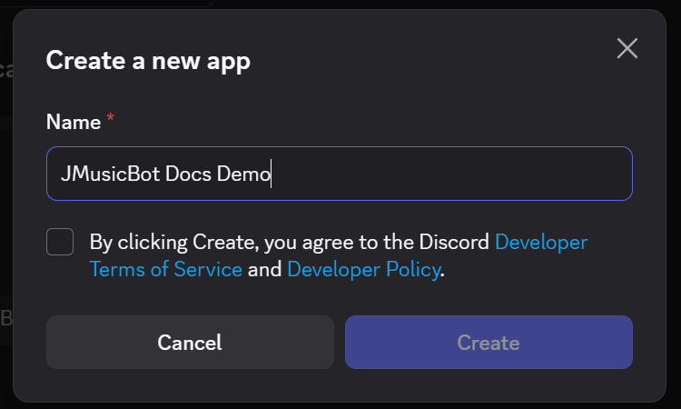
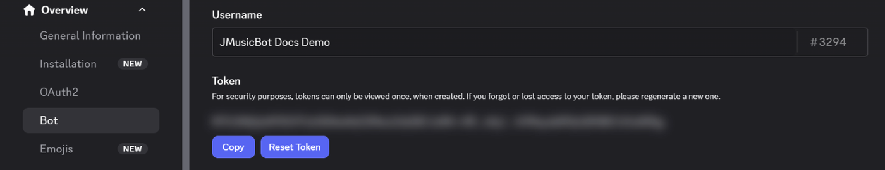
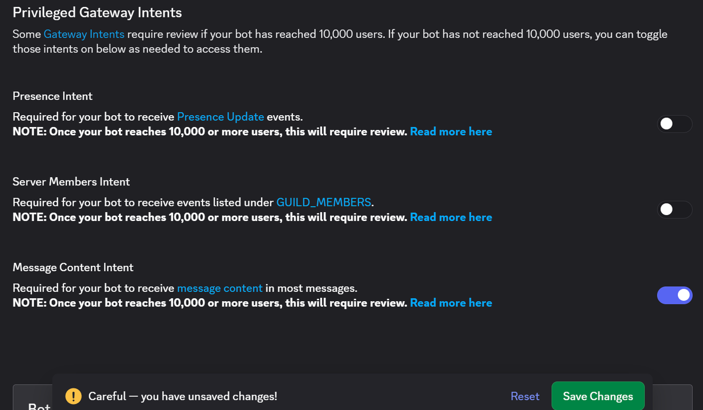

# Get a bot token

The token is the password your copy of the bot uses to log in to Discord. You create it once, in the Discord
Developer Portal, and give it to the bot on its first run.

## Create the application

1. Open the [Discord Developer Portal](https://discord.com/developers/applications) and sign in.
2. Select **New Application**.
3. Type the name you want people to see for the bot, agree to the terms, and select **Create**.

<figure class="oa-media" markdown>
{ width="430" }
</figure>

## Copy the token

1. In the menu on the left, open **Bot**.
2. Select **Reset Token** and confirm. Discord shows the new token once.
3. Select **Copy** and keep the token somewhere safe until the bot asks for it.

<figure class="oa-media" markdown>

</figure>

## Turn on Message Content Intent

Still on the **Bot** page, scroll to **Privileged Gateway Intents**, turn on **Message Content Intent**, and
select **Save Changes**.

!!! warning "Message Content Intent must be on"
    The bot asks Discord for this intent when it logs in. If it's off, Discord refuses the connection and the bot
    stops with "Your bot is missing required Discord intents!", so neither prefix nor slash commands work. It's the
    only privileged intent the bot needs, so leave the others off.

<figure class="oa-media" markdown>

</figure>

## Put it in config.txt

The first time the bot runs, it asks you for the token and saves it (see [First run](first-run.md)). If you already
have a `config.txt`, paste the token there instead, and set `owner` to your own Discord user ID;
[Find your user ID](user-id.md) shows where to get it.

```hocon
discord {
  token = "paste-your-token-here"
  owner = 123456789012345678
}
```

## Keep it secret

!!! danger "Anyone with the token controls your bot"
    Don't post it in Discord, in a screenshot, or in a GitHub issue. If it leaks, go back to the **Bot** page and
    select **Reset Token**. The old token stops working right away; paste the new one into `config.txt` and restart
    the bot.

Next: [Find your user ID](user-id.md).
