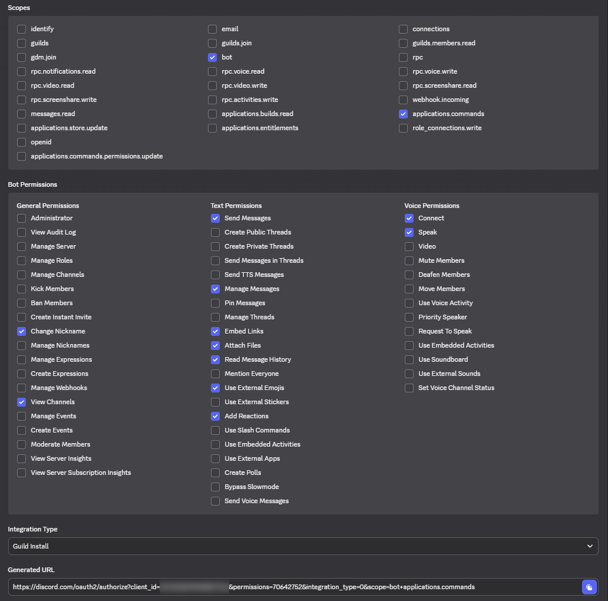

# Invite the bot

Your bot needs an invite link before it can join a server. You need the **Manage Server** permission in that
server.

## Use the link the bot prints

When the bot starts and isn't in any server yet, it prints an invite link in the console, and in a pop-up if the
desktop app is open:

```text
This bot is not on any guilds! Use the following link to add the bot to your guilds!
https://discord.com/oauth2/authorize?client_id=...&permissions=...&scope=bot
```

Open the link, pick your server and select **Authorize**. The link already asks for the right permissions.

## Or make a link in the Developer Portal

1. Open your application in the [Developer Portal](https://discord.com/developers/applications) and go to
   **OAuth2**.
2. In **OAuth2 URL Generator**, tick the scope **bot**. It includes `applications.commands`, which slash commands
   need; ticking that as well does no harm.
3. Under **Bot Permissions**, tick the permissions listed below.
4. Copy the generated URL at the bottom, open it, pick your server and select **Authorize**.

<figure class="oa-media" markdown>

</figure>

## Permissions the bot uses

| Permission | Why |
|---|---|
| View Channels | See the text and voice channels it works in. |
| Send Messages | Reply to commands. |
| Read Message History | Edit and follow up on its own messages. |
| Add Reactions | Add the numbered reactions you pick from in `search` results. |
| Embed Links | Show now-playing and queue messages. |
| Attach Files | Send files, such as the owner's `debug` report. |
| Manage Messages | Clean up menus and the music channel with `clearchannel`. |
| Use External Emojis | Use custom emojis in its messages. |
| Connect | Join voice channels. |
| Speak | Play music. |
| Change Nickname | Part of the bot's standard set. It doesn't rename itself today. |

## Check it works

Join a voice channel and type `/play` followed by a song name. Slash commands can take a minute to appear the
first time. If they don't show up, see [Troubleshooting](../help/troubleshooting.md#slash-commands-dont-show-up).

Next: [Run with Docker](docker.md), or keep it running with [Run as a service](service.md).
