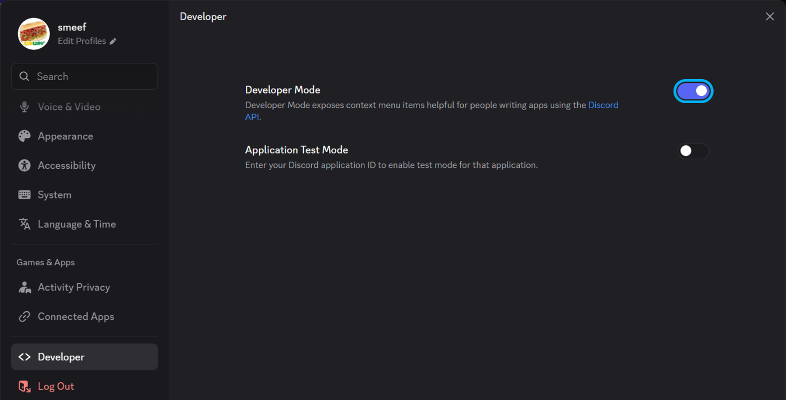
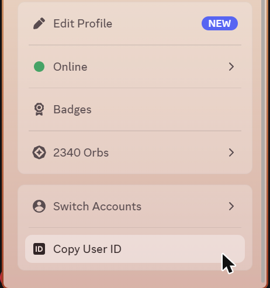

# Find your user ID

The bot's owner can use owner-only commands, gets update notices, and can always control the music. The bot knows
it's you by your Discord **user ID**: a number 17 to 20 digits long, such as `123456789012345678`. It isn't your
username.

## Turn on Developer Mode

Discord only shows IDs once Developer Mode is on.

1. In Discord, open **User Settings** (the gear next to your name).
2. Go to **Developer**, near the bottom of the list. Older versions of Discord call it **Advanced**.
3. Turn on **Developer Mode**.

<figure class="oa-media" markdown>

</figure>

## Copy your ID

1. Click your avatar in the bottom-left corner of Discord.
2. Choose **Copy User ID** at the bottom of the menu that opens. You can also right-click your name in a server's
   member list or on one of your messages (long-press on a phone) and choose **Copy User ID** there.

<figure class="oa-media" markdown>
{ width="264" }
</figure>

You'll paste this number when the bot asks for the owner on its first run, or into `config.txt`:

```hocon
discord {
  owner = 123456789012345678
}
```

The owner value is a plain number, without quotes.

!!! tip "Not the bot's ID"
    Make sure you copy **your** ID, not the bot's or the server's. If owner-only commands such as `shutdown` say
    you don't have permission, the ID is probably wrong.

Next: [Run the bot for the first time](first-run.md).
